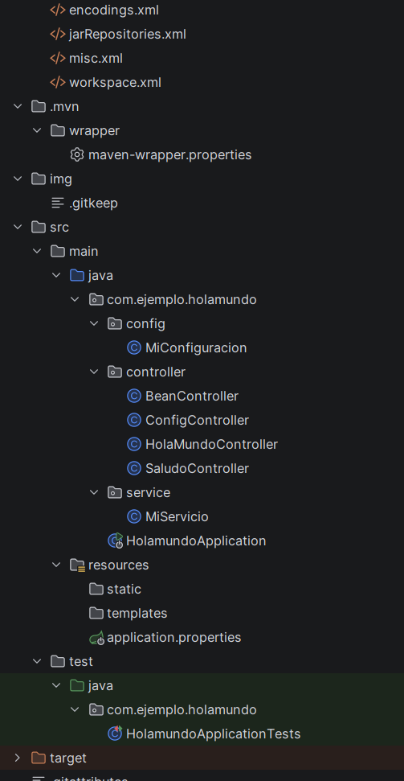
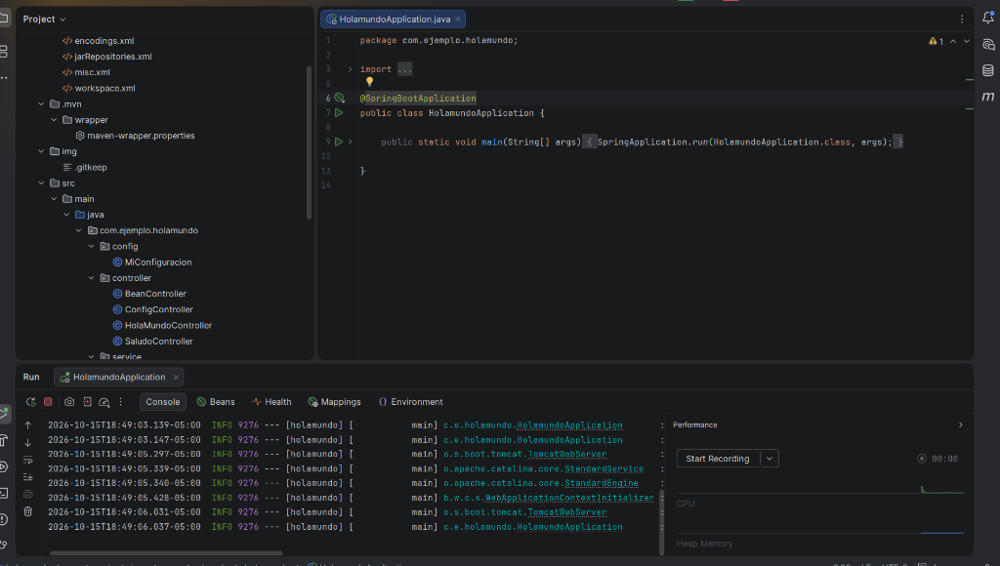
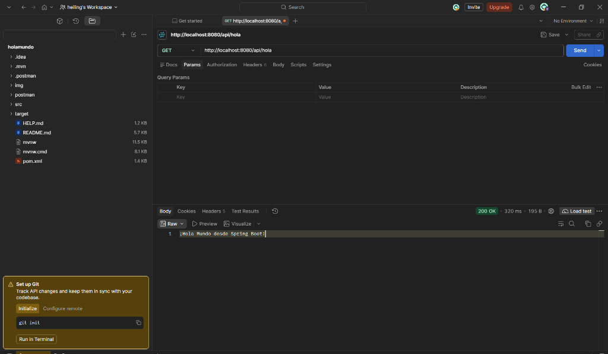
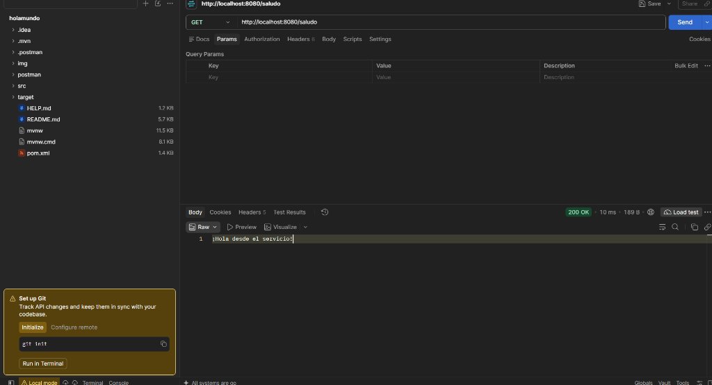
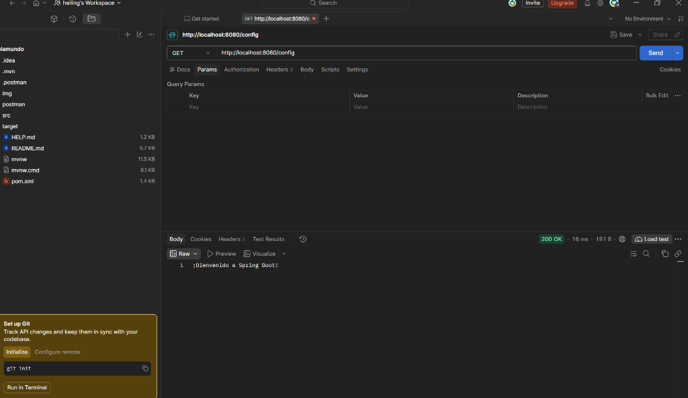
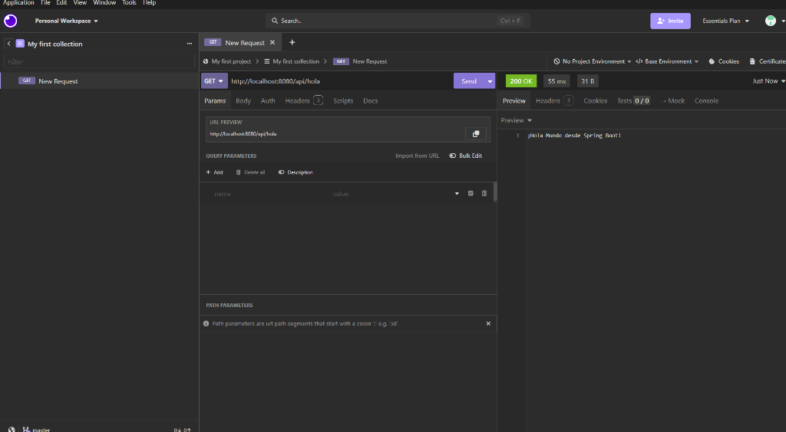
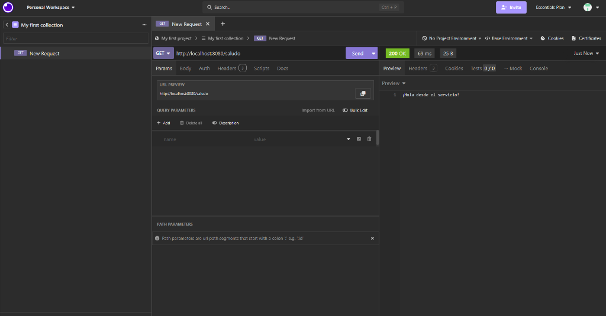
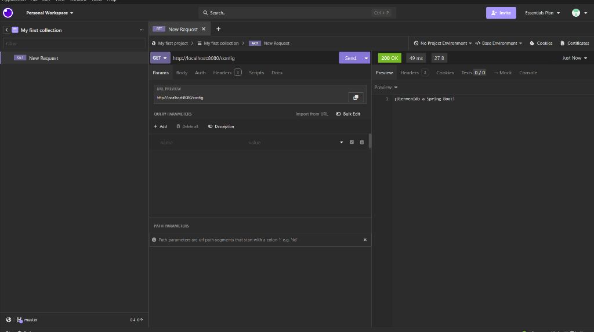
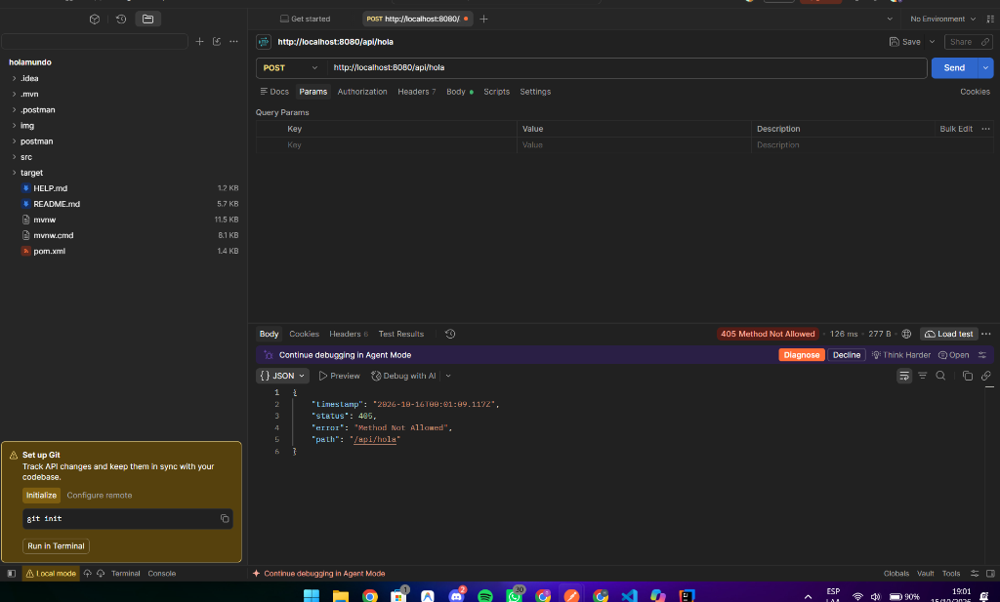
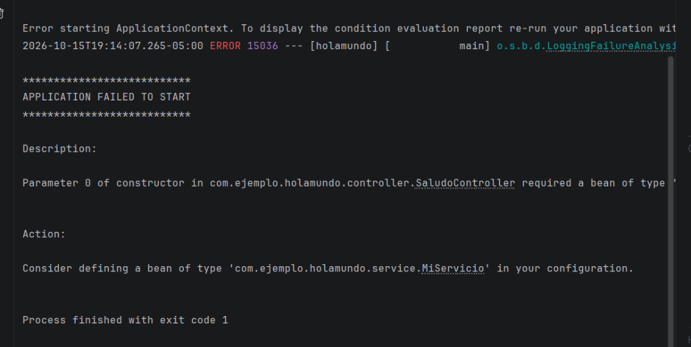

# Actividad práctica: Mi primer proyecto con Spring Boot (`holamundo`)

Aplicación **Spring Boot 4** con endpoints REST aplicando controladores (`@RestController`), servicios (`@Service`), inyección de dependencias por constructor (`@Autowired`), configuración externa (`@Value`) y beans personalizados (`@Configuration` / `@Bean`).

---

## Datos del Proyecto

| Campo | Valor |
|---|---|
| **Nombre / Artifact** | `holamundo` |
| **Group** | `com.ejemplo` |
| **Package name** | `com.ejemplo.holamundo` |
| **Tipo de proyecto** | Maven |
| **Lenguaje** | Java (JDK 25) |
| **Spring Boot** | 4.1.1 |
| **Packaging** | Jar |
| **Dependencia** | Spring Web (`spring-boot-starter-webmvc`) |

---

## Estructura del Proyecto

```text
src/main/java/com/ejemplo/holamundo/
├── HolamundoApplication.java
├── config/
│   └── MiConfiguracion.java
├── controller/
│   ├── HolaMundoController.java
│   ├── SaludoController.java
│   ├── ConfigController.java
│   └── BeanController.java
└── service/
    └── MiServicio.java
src/main/resources/
└── application.properties
```

---

## Endpoints Implementados

| Método | Endpoint | Status Esperado | Respuesta | Descripción |
|---|---|---|---|---|
| `GET` | `http://localhost:8080/api/hola` | `200 OK` | `¡Hola Mundo desde Spring Boot!` | Controlador básico (`HolaMundoController`) |
| `GET` | `http://localhost:8080/saludo` | `200 OK` | `¡Hola desde el servicio!` | Inyección de `MiServicio` en `SaludoController` |
| `GET` | `http://localhost:8080/config` | `200 OK` | `¡Bienvenido a Spring Boot!` | Lectura de `application.properties` con `@Value` |
| `GET` | `http://localhost:8080/bean` | `200 OK` | `¡Este es un mensaje de un bean!` | Reto Parte 7: Inyección de `@Bean` desde `MiConfiguracion` |
| `POST` | `http://localhost:8080/api/hola` | `405 Method Not Allowed` | JSON de error `405` | Reto Parte 8: Petición con método HTTP no permitido |

---

## Entregables — Capturas de Pantalla

### 1. Estructura del proyecto en el IDE


---

### 2. Consola con el mensaje `Tomcat started on port 8080`


---

### 3. Pruebas de los endpoints en Postman (Status 200 OK)

#### 3.1 Endpoint `GET /api/hola` en Postman


#### 3.2 Endpoint `GET /saludo` en Postman


#### 3.3 Endpoint `GET /config` en Postman


---

### 4. Pruebas de los endpoints en Insomnia (Status 200 OK)

#### 4.1 Endpoint `GET /api/hola` en Insomnia


#### 4.2 Endpoint `GET /saludo` en Insomnia


#### 4.3 Endpoint `GET /config` en Insomnia


---

### 5. Reto de método equivocado (`405 Method Not Allowed`)
Prueba enviando una petición `POST` a `http://localhost:8080/api/hola`:



---

### 6. Reto de `@Service` (Error al quitar la anotación `@Service`)
Error en consola al comentar `@Service` en `MiServicio.java`:
```text
Parameter 0 of constructor in com.ejemplo.holamundo.controller.SaludoController required a bean of type 'com.ejemplo.holamundo.service.MiServicio' that could not be found.
```



---

### 7. Pregunta de reflexión

**¿Qué diferencia hay entre `@RestController` y `@Service`, y por qué Spring puede entregar el servicio al controlador sin usar `new`?**

1. **Diferencia entre `@RestController` y `@Service`:**
   - **`@RestController`** se utiliza en la **capa de presentación / comunicación HTTP**. Define que la clase recibe peticiones web REST (`GET`, `POST`, `PUT`, `DELETE`) en rutas específicas (`@RequestMapping`, `@GetMapping`) y devuelve directamente los datos serializados (texto o JSON) en el cuerpo de la respuesta HTTP.
   - **`@Service`** se utiliza en la **capa de lógica de negocio (servicio)**. Contiene las operaciones, reglas de negocio y procesamiento de datos de la aplicación, manteniéndolos desacoplados de la capa web.

2. **¿Por qué Spring puede entregar el servicio al controlador sin usar `new`?**
   - Gracias al principio de **Inversión de Control (IoC)** y a la **Inyección de Dependencias (DI)** que maneja el contenedor de Spring (`ApplicationContext`).
   - Cuando la aplicación inicia con `@SpringBootApplication`, Spring ejecuta `@ComponentScan` buscando clases anotadas dentro del paquete `com.ejemplo.holamundo`. Al encontrar `@Service` en `MiServicio`, Spring crea automáticamente una instancia única (un **Bean**) y la registra en su contenedor.
   - Luego, al crear `SaludoController`, Spring detecta que su constructor (anotado con `@Autowired`) requiere un objeto de tipo `MiServicio`, por lo que busca ese Bean en su contenedor y se lo entrega automáticamente sin que el programador tenga que instanciarlo manualmente con `new MiServicio()`.

---

## Cómo ejecutar el proyecto

Desde la terminal en la raíz del proyecto:

```bash
./mvnw spring-boot:run
```

En Windows PowerShell / CMD:

```powershell
.\mvnw.cmd spring-boot:run
```
